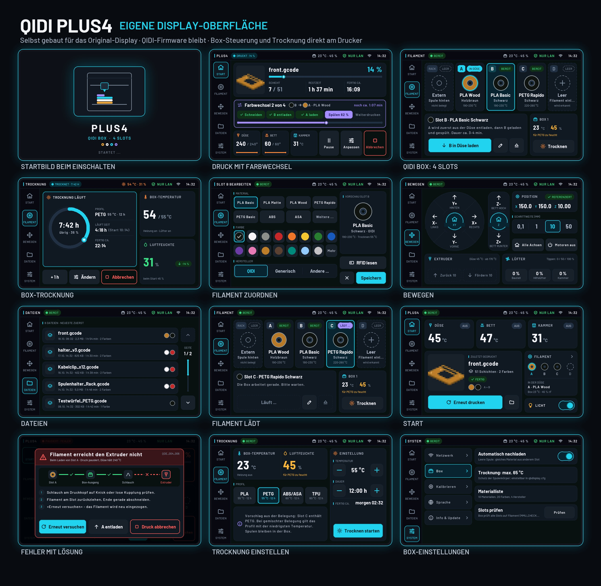

# qbdisplay – neue Display-Oberfläche für den QIDI Plus4

*English version below.*



`qbdisplay` ersetzt die Oberfläche auf dem eingebauten Touch-Display des **QIDI Plus4**.
Die **QIDI-Firmware bleibt unverändert** (Klipper, Moonraker, Box-Steuerung); ausgetauscht
wird nur QIDIs Display-Programm. Der Rückweg zur QIDI-Oberfläche ist ein Befehl.

- Druckübersicht mit Fortschritt, Restzeit, Farbwechsel-Schritten und Temperaturen
- **QIDI Box** direkt am Display: Slots laden, entladen, auswerfen, Material/Farbe/Hersteller
  zuordnen, RFID lesen, „in der Düse“ auf einen Blick
- **Mit oder ohne Box:** ohne Box zeigt die Filament-Seite die externe Spule; Box im Betrieb
  an- oder abstecken wird erkannt. Mehrere Boxen (bis 4) lassen sich durchblättern
- **Box-Trocknung** mit Profilen, Restzeit und Feuchte-Bewertung je Material; vor dem Start
  Hinweis auf eingelegtes Filament (die Spulen drehen sich) mit **Alle auswerfen**
- Bewegen, Dateien, Lüfter, Licht, Netzwerk-Status („Nur LAN“)
- **WLAN einrichten** am Display (ab 0.5): Netz wählen, Passwort über die Bildschirmtastatur.
  Das neue Netz wird erst ausprobiert und nur gespeichert, wenn es klappt – sonst bleibt das alte
  WLAN aktiv.
- **Notbewegung** (ab 0.6): Bett/Kopf ohne Referenzfahrt freifahren, z. B. wenn die Düse nach
  einem abgebrochenen Druck im Teil steckt (kleine Schritte, danach gehen die Motoren aus).
- **Vorschaubild einstellbar** (ab 0.6, System → Anzeige): Schnell, Auto, Scharf oder Sehr scharf.
  Das Display kann keine Bilder laden, das Vorschaubild ist ein Mosaik aus Farbflächen; feiner
  heißt mehr Flächen und damit längere Übertragung beim Seitenwechsel. „Auto“ nimmt die feinste
  Stufe, die noch schnell genug ist.
- Deutsch und Englisch
- Startbild beim Einschalten, startet automatisch

## Voraussetzungen

- QIDI Plus4 mit QIDI-Firmware **2.1.1** (andere Versionen ungetestet), QIDI Box optional
- SSH-Zugang zum Drucker (Benutzer `mks`)
- Kein laufender Druck während der Installation

## Installation

1. Die neueste `qbdisplay-plus4-<version>.tar.gz` unter **Releases** herunterladen.
2. Auf den Drucker kopieren und dort entpacken:
   ```sh
   scp qbdisplay-plus4-*.tar.gz mks@<drucker-ip>:~
   ssh mks@<drucker-ip>
   tar -xzf qbdisplay-plus4-*.tar.gz
   mv qbdisplay-plus4-*/ qbdisplay
   cd qbdisplay && ./install.sh
   ```
3. Das Skript sichert QIDIs Display-Datei, spielt die neue auf (ca. 2 min, Display solange
   dunkel), schaltet QIDIs Display-Programm ab und startet `qbdisplay` als Dienst.

Einstellungen: `~/printer_data/config/qbdisplay.cfg` (auch in Fluidd unter „Konfiguration“).

## Zurück zur QIDI-Oberfläche

```sh
cd ~/qbdisplay && ./uninstall.sh
```
Spielt die gesicherte QIDI-Display-Datei wieder auf (ca. 7 min) und startet QIDIs Programm.

## Gut zu wissen

- **Updates von qbdisplay (ab 0.4):** System → Info & Update → „Suchen“, dann „Installieren“.
  Das Paket wird von GitHub geladen und gegen die Prüfsumme geprüft; startet die neue Version nicht,
  geht es automatisch zurück zur alten. Testversionen gibt es nur mit `prerelease: yes` im Abschnitt
  `[update]` der `qbdisplay.cfg`.
- **Von 0.3.x oder älter** einmal von Hand aktualisieren: neues Paket entpacken, den alten Ordner
  beiseitelegen (`mv qbdisplay qbdisplay-alt`), neuen Ordner in `qbdisplay` umbenennen,
  `./install.sh` ausführen. Danach geht es am Display.
- **Von 0.4.x auf 0.5** ebenso einmal von Hand (0.5 bringt ein neues Hilfsskript mit Root-Rechten
  für das WLAN; das ersetzt das Update am Display aus Sicherheitsgründen nie selbst). Die
  Display-Datei ist unverändert, `install.sh` spielt sie dann nicht neu auf.
- **WLAN:** Der eingebaute Stick kann nur 2,4 GHz und WPA/WPA2 mit Passwort (kein reines WPA3,
  kein Firmen-WLAN).
- **QIDI-Updates** laufen über QIDIs Oberfläche: „Zu QIDI“ wechselt direkt am Display zurück
  (ca. 7 min), dann wie gewohnt updaten, danach wieder `./install.sh`.
- **QIDI-Cloud/App:** entfallen mit qbdisplay (QIDI Studio im LAN funktioniert weiter).
- **Nach Stromausfall** fragt qbdisplay (noch) nicht nach dem Fortsetzen des Drucks.
- **Mehrere Boxen:** Anzeige und Laden aller Boxen; Trocknen am Display bisher nur für Box 1.
  Mangels zweiter Box noch nicht am Gerät getestet – Rückmeldungen willkommen.
- Inoffizielles Projekt, nicht von QIDI. Nutzung auf eigene Gefahr.

## Selbst bauen

Die Display-Datei (`.tft`) entsteht aus Schriften (Barlow, SIL OFL), Symbolen und Startbild:
`tools/build_tjc_project.py` erzeugt das TJC-Projekt, der TJC-Editor „USART HMI“ kompiliert es.
Details: `tjc-projekt/ANLEITUNG.md`. Tests: `python -m unittest discover -s tests`.
Vorschau ohne Drucker: `python tools/render_all.py` (Bilder in `preview/`).

---

# qbdisplay – new display UI for the QIDI Plus4

`qbdisplay` replaces the user interface on the built-in touch display of the **QIDI Plus4**.
The **QIDI firmware stays untouched** (Klipper, Moonraker, box control); only QIDI's display
program is swapped. Going back to the QIDI UI is one command.

- Print overview with progress, time left, colour-change steps and temperatures
- **QIDI Box** on the display: load, unload, eject slots, assign material/colour/vendor,
  read RFID, see at a glance what is in the nozzle
- **With or without a box:** without one, the filament page shows the external spool; plugging
  the box in or out while running is detected. Several boxes (up to 4) can be paged through
- **Box drying** with profiles, time left and humidity rating per material; before it starts,
  a reminder about inserted filament (the spools rotate) with **Eject all**
- Move, files, fans, light, network status ("LAN only")
- **Wi-Fi setup** on the display (from 0.5): pick a network, enter the password on the on-screen
  keyboard. The new network is tried first and only saved if it works – otherwise the old one stays
  active.
- **Free move** (from 0.6): move the bed/head without homing first, e.g. to free the nozzle
  after a failed print (small steps only; the motors are turned off afterwards).
- **Adjustable preview image** (from 0.6, System → Display): Fast, Auto, Sharp or Sharpest. The
  display cannot load pictures, so the preview is a mosaic of colour blocks; finer means more blocks
  and a longer transfer when the page changes. "Auto" picks the finest level that is still fast.
- English and German
- Boot screen, starts automatically

## Requirements

- QIDI Plus4 with QIDI firmware **2.1.1** (other versions untested), QIDI Box optional
- SSH access to the printer (user `mks`)
- No print running during installation

## Install

1. Download the latest `qbdisplay-plus4-<version>.tar.gz` from **Releases**.
2. Copy it to the printer and unpack it there:
   ```sh
   scp qbdisplay-plus4-*.tar.gz mks@<printer-ip>:~
   ssh mks@<printer-ip>
   tar -xzf qbdisplay-plus4-*.tar.gz
   mv qbdisplay-plus4-*/ qbdisplay
   cd qbdisplay && ./install.sh
   ```
3. The script backs up QIDI's display file, flashes the new one (about 2 min, screen stays dark),
   disables QIDI's display program and starts `qbdisplay` as a service.

Set `language: en` in `~/printer_data/config/qbdisplay.cfg` or switch it on the display
under System → Language.

## Back to the QIDI UI

```sh
cd ~/qbdisplay && ./uninstall.sh
```

## Good to know

- **qbdisplay updates (from 0.4):** System → Info & Update → "Check", then "Install". The package
  is downloaded from GitHub and verified against its checksum; if the new version does not start,
  the old one is restored automatically. Test versions are only offered with `prerelease: yes` in
  the `[update]` section of `qbdisplay.cfg`.
- **From 0.3.x or older** update once by hand: extract the new package, move the old folder aside
  (`mv qbdisplay qbdisplay-old`), rename the new folder to `qbdisplay`, run `./install.sh`. After
  that, updates work from the display.
- **From 0.4.x to 0.5** also once by hand (0.5 brings a new root helper script for Wi-Fi; for
  security the display update never replaces it by itself). The display file is unchanged, so
  `install.sh` does not flash it again.
- **Wi-Fi:** the built-in stick only does 2.4 GHz and WPA/WPA2 with a password (no WPA3-only, no
  enterprise Wi-Fi).
- **QIDI updates** run through QIDI's UI: "To QIDI" switches back right on the display (about
  7 min), update as usual, then run `./install.sh` again.
- **QIDI cloud/app** are not available with qbdisplay (QIDI Studio on the LAN keeps working).
- **After a power loss** qbdisplay does not (yet) offer to resume the print.
- **Several boxes:** all boxes are shown and can be loaded; drying from the display covers box 1
  only so far. Not yet tested on a printer with two boxes – feedback welcome.
- Unofficial project, not affiliated with QIDI. Use at your own risk.

## License

GPL-3.0-or-later (see `LICENSE`). Fonts: Barlow, SIL Open Font License (`tjc-projekt/fonts/OFL.txt`).
